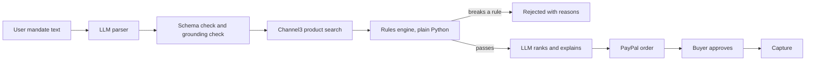

# Mandate Agent

> An AI shopping agent that buys on your behalf, but only inside the spending rules you set. Payments run through PayPal.

## The problem

AI agents can already search and shop, but people don't trust them with their money. Handing an agent your payment details is all-or-nothing: either it can spend freely, or it can't act at all.

## Our solution

You give the agent a **mandate** in plain language, for example:

> "A desk lamp under $60, rated 4 stars or above, delivered within a week."

The agent turns this into strict rules, finds matching products, and checks every candidate against those rules. Depending on the result, it will:

- **Auto-pay** if the item is within your auto-approve limit,
- **Ask for your approval** if it passes the rules but costs more than that limit,
- **Reject** the item if it breaks any rule, and tell you exactly why.

**The key design idea: the LLM never decides whether money moves.** The LLM only (1) translates your request into structured rules and (2) ranks and explains the products that already passed. The payment decision is made by plain, tested Python code.

## How it works

```
Mandate (text)
   -> LLM parser -> validated Mandate (JSON)
   -> Product search
   -> Rules engine (deterministic Python) -> auto_pay | needs_approval | reject
   -> LLM ranks and explains the passing products
   -> PayPal order -> buyer approval -> capture
```



## Why PayPal and AI both matter

- **AI (Gemini):** turns a plain-language request into structured rules, and ranks and explains the products that already passed those rules.
- **PayPal (Orders API, Sandbox):** creates the order and captures payment only after the buyer approves.

Neither works alone: without AI there is no agent, and without PayPal the agent cannot safely complete a purchase.

## Features

- Natural-language mandate -> validated structured rules
- Deterministic rules engine (budget, rating, delivery time, blocked merchants, currency)
- Real product search through Channel3
- LLM ranking and a short explanation, only among products that already passed the rules
- Unverifiable rules route to human approval, never auto-pay
- Human approval flow with PayPal (create order, buyer approval, capture)
- Full audit trail: why each product was chosen or rejected
- Per-IP rate limit and input length cap on the public API
  

## Safety design

- The rules engine is plain code with unit tests, not an LLM.
- The LLM never decides whether money moves. It can only reorder products that already passed the rules, and it cannot move a product to a higher approval tier.
- Product titles are untrusted text. The ranking prompt tells the model to treat them as names only, and the code ignores any product ID the model invents. If the model fails, the rules-based order is used.
- Money amounts the LLM extracts (budget, auto-buy limit) must appear in the user's own text; otherwise the request is rejected. This blocks invented budgets.
- Rules that cannot be verified (e.g., missing rating or delivery data) never auto-pay. They are routed to human approval with an explicit reason.
- Secrets live in `.env` and are never committed.

## Tech stack

Python, FastAPI, Pydantic, httpx, Gemini API, Channel3 API, React, PayPal Orders API (Sandbox)

## Getting started

**Prerequisites:** Python 3.11+, Node.js (for the frontend), a PayPal Developer account.

```bash
git clone https://github.com/swetasingh9497-hash/paypal-mandate-agent.git
cd paypal-mandate-agent
python -m venv .venv
# Windows: .venv\Scripts\activate   |  Mac/Linux: source .venv/bin/activate
pip install -r requirements.txt
cp .env.example .env     # Windows: copy .env.example .env
```

Fill in `.env`:

### Get your keys

- **PayPal:** create a Sandbox app at developer.paypal.com and copy its Client ID and Secret.
- **Gemini:** free key from aistudio.google.com/app/apikey (no billing needed).
- **Channel3:** free key from trychannel3.com/sign-up/developer.

Fill in `.env`:

```
PAYPAL_CLIENT_ID=
PAYPAL_SECRET=
GEMINI_API_KEY=
CHANNEL3_API_KEY=
LLM_MODEL=gemini-3.5-flash-lite
FRONTEND_URL=http://localhost:5173
BACKEND_URL=http://localhost:8000
```

Model names change over time. If the model is rejected, pick a current free model in Google AI Studio and update `LLM_MODEL`.
Run the backend:

```bash
uvicorn app.main:app --reload
```

Run the tests:

```bash
pytest -q
```

Frontend: <add steps once the frontend exists>

> **Note:** This project uses the PayPal **Sandbox**. No real money moves. To test checkout, use a Sandbox *Personal* (buyer) account created with the country set to the United States.

## Demo

- Live app: <link>
- Demo video: <link>

## Team

- Sweta Singh - agent core and AI
- Vaibhav Vishwakarma - frontend and payment flow

## Limitations and roadmap

- PayPal Sandbox only; no real money moves.
- The PayPal order is created against our merchant account, not the store that sells the product. Fulfillment with the store is out of scope.
- PayPal Orders always require buyer approval, so “auto-pay” means “within your rules, order created without asking in the app”. Truly hands-free payment would need vaulted payment methods.
- Product data comes from Channel3 and has no ratings or delivery times, so rating and delivery rules route to human approval.
- US products and USD only.
- Free-tier API quotas limit how many live runs are possible.
- Pack sizes and quantities (e.g., "Set of 2") are not interpreted.
- Shipping and availability by region are not verified.

## License

MIT
